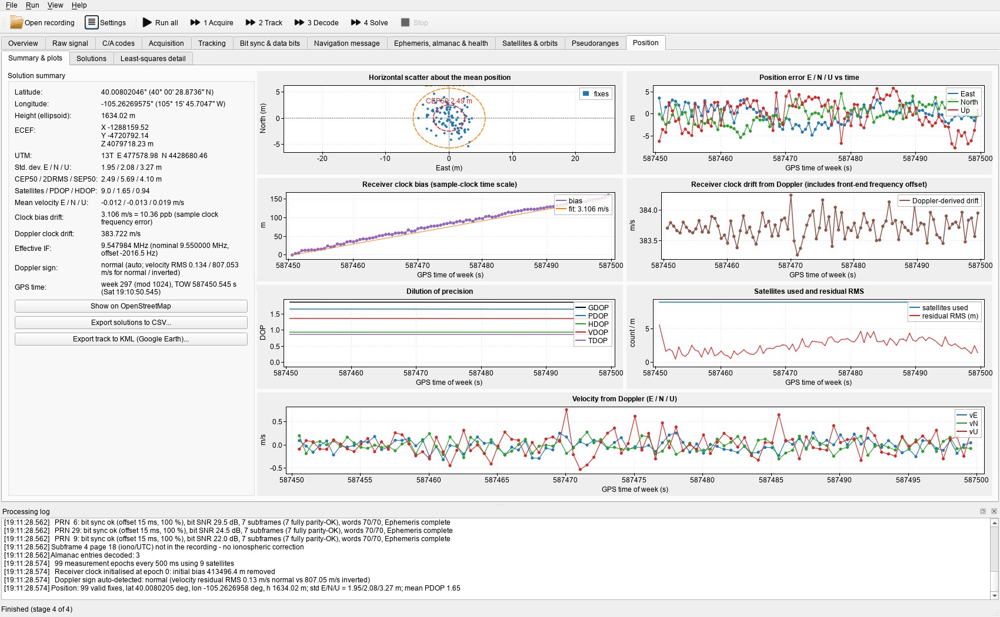

# Software GPS Receiver (Qt)

A post-processing GPS L1 C/A receiver for recorded IF sample files. It is built to show every step of the
signal processing: raw-signal statistics, C/A code generation, acquisition, tracking loops, bit
synchronisation, navigation-message decoding with parity, ephemeris/almanac/health, satellite orbits,
pseudoranges, and the least-squares position/velocity/time solution.



## Building and running in Qt Creator

1. Open `CMakeLists.txt` in Qt Creator (*File > Open File or Project*).
2. Select the **Desktop Qt 6.12.0 MinGW 64-bit** kit.
3. Choose the **Release** build configuration and press **Run** (Ctrl+R).
   Debug builds also work: the DSP core (`gnsscore`) is optimised even in Debug
   (option `GNSS_OPTIMIZE_CORE_IN_DEBUG`), so only the GUI is unoptimised.
4. On first start the program looks for a large `*.bin` file in the working directory and up to five levels above
   the executable, so `GPSdata-DiscreteComponents-fs38_192-if9_55.bin` is opened automatically. Otherwise use
   *File > Open*. After that the last file is reopened.
5. Press **F5** (*Run all*), or run the stages one at a time with F6 (acquire), F7 (track), F8 (decode) and F9 (solve).

The sampling frequency, IF and sample format come from the file name (`fs38_192` = 38.192 MHz,
`if9_55` = 9.55 MHz, int8 real samples by default). You can change them in *File > Settings*, along with every
acquisition, tracking-loop and navigation parameter.

The file name gives the IF rounded to 9.55 MHz. The true IF of this recording is fs/4 = 9.548 MHz. The receiver
copes either way, and the Position page reports the measured *effective IF* (9.547984 MHz) from the
Doppler/clock-drift solution. If you set the IF to 9.548 MHz, the Doppler values are shown without the
2 kHz offset.

## Editing the GUI in Qt Designer

Every page, the main window and the settings dialog are `.ui` forms in `src/gui/`:

| Form | Content |
|---|---|
| `MainWindow.ui` | menus, toolbar, log dock, and the tab widget holding all pages (each tab is a promoted page widget) |
| `SettingsDialog.ui` | input, acquisition, tracking and navigation settings |
| `OverviewPage.ui` | recording info, pipeline status, satellite summary, position summary, algorithm documentation |
| `RawSignalPage.ui` | time-domain samples, ADC histogram, Welch PSD, spectrogram, statistics |
| `CaCodePage.ui` | G1/G2/C-A sequences, autocorrelation, cross-correlation, sampled correlation peak, code spectrum, code table |
| `AcquisitionPage.ui` | metric and C/N0 bars, results table, correlation surface heat map, code/Doppler slices, fine-frequency spectrum |
| `TrackingPage.ui` | 12 per-channel loop plots, all-channel overlays, multi-correlator shape, loop design tables |
| `BitSyncPage.ui` | transition histogram, prompt with bit edges, soft bits, preamble correlation, raw bit grid |
| `NavMessagePage.ui` | subframe list, words with parity check, colour-coded bit map, decoded fields with scaling and interpretation |
| `EphemerisPage.ui` | ephemeris table, almanac, health/A-S/configuration, iono/UTC, special message, NMCT, received pages |
| `SatellitesPage.ui` | sky plot, elevation, sub-satellite points, satellite state, step-by-step Kepler computation |
| `MeasurementsPage.ui` | per-epoch pseudorange corrections table, PR change, residuals, code-minus-carrier, Doppler, tropo, SV clock |
| `PositionPage.ui` | summary, scatter/ENU/clock/DOP/velocity plots, solutions table, least-squares iterations, H and Q matrices |

Notes for editing:

* The plots and tables are **promoted widgets**: `gui::PlotWidget` and `gui::SkyPlotWidget` (from `QWidget`) and
  `gui::DataTable` (from `QTableWidget`). You can move, resize, split or regroup them freely.
* Plot titles and axis labels are dynamic properties of the promoted widget (`title`, `xLabel`, `yLabel`, plus
  `aspectLocked` and `legendVisible`). Edit them in the Property Editor. Some titles are replaced at run time
  with PRN-specific text.
* Keep the **objectName** of any control the code uses (e.g. `channelCombo`, `epochSpin`, `surfacePlot`). The code
  accesses them as `ui->name`.
* Table **column headers are set in code** (`setColumns(...)` in each page's constructor), because the code fills
  the table by column index. Change the header list and the matching `setNum/setText` column numbers together.
* The combo boxes in `SettingsDialog.ui` list their items in enum order (sample format, Doppler sign). Keep that order.

Plot interaction: mouse wheel zooms (Ctrl = x only, Shift = y only), left-drag box-zooms, right-drag pans,
double-click resets, and right-click opens a menu (copy/save image, export CSV, legend, grid). The tracking-page
time axes are linked. Tables support Ctrl+C and *Export to CSV* from the context menu.

## Command line

```
gnss_cli <file.bin> [--ms N] [--channels N] [--fs Hz] [--if Hz] [--csv solutions.csv]
SoftGpsReceiver <file.bin> --screenshots <dir>   # process, save a PNG of every page and sub-tab, exit
```

## Results for the sample recording

`GPSdata-DiscreteComponents-fs38_192-if9_55.bin` is 50.08 s of 4-bit-quality int8 real samples.

* 9 satellites acquired (PRN 3, 6, 9, 15, 18, 21, 22, 26, 29). All tracked with 100 % phase lock at 42–51 dB-Hz.
* 63 subframes decoded, 630/630 words pass parity, and all 9 ephemerides complete and consistent.
* 99 fixes (every 0.5 s): **40.00802° N, 105.26270° W, h = 1634 m** (Boulder, Colorado), with σ E/N/U =
  1.95/2.08/3.27 m and PDOP 1.65.
* GPS week 297 (mod 1024), i.e. 2005-05-07 19:10 UTC.
* Sample clock error +10.4 ppb (clock-bias slope 3.1 m/s). Effective IF 9.547984 MHz.
* Subframe 4 page 18 (ionosphere/UTC) is broadcast every 12.5 min and is not in this 50-s recording, so no
  ionospheric correction is applied (residual RMS ≈ 5 m).

Processing the whole file takes about 13 s on a 12-core CPU: acquisition 2 s, tracking 9 s with one thread per channel.

## Code structure

```
src/core/            GUI-independent receiver (Qt Core + Concurrent only)
  Settings           parameters, file-name parsing, persistence
  SignalSource       memory-mapped sample file (int8/uint8/int16, real or I/Q)
  Fft                radix-2 + Bluestein FFT (any length)
  CaCode             G1/G2 Gold code generator (tap and delay methods), ICD table
  SignalAnalysis     statistics, Welch PSD, spectrogram
  Acquisition        parallel code-phase search, fine frequency estimation
  Tracking           FLL-assisted Costas PLL + early/late DLL, C/N0, lock detector, multi-correlator
  NavMessage         bit sync, preamble search, parity, IS-GPS-200 field layouts, ephemeris/almanac/health/iono
  Ephemeris          satellite position/velocity/clock (Table 20-IV) with step-by-step trace
  Geodesy            ECEF/geodetic/ENU/UTM, az/el, Saastamoinen, Klobuchar, GPS time
  Pvt                pseudoranges, corrections, iterative least squares, DOP, Doppler velocity
  Receiver           pipeline orchestration (runs on a worker thread)
src/gui/             Qt Widgets front end (.ui forms + page classes, PlotWidget, SkyPlotWidget, DataTable)
src/cli/             command-line front end
docs/algorithms.html algorithm description shown on the Overview page
```
